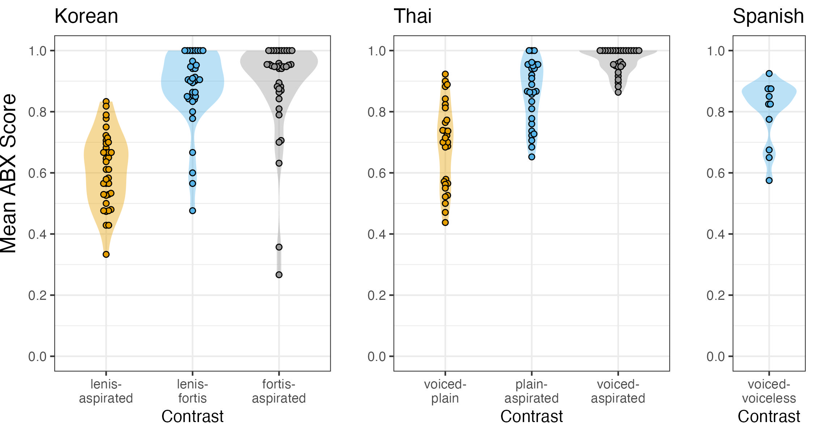
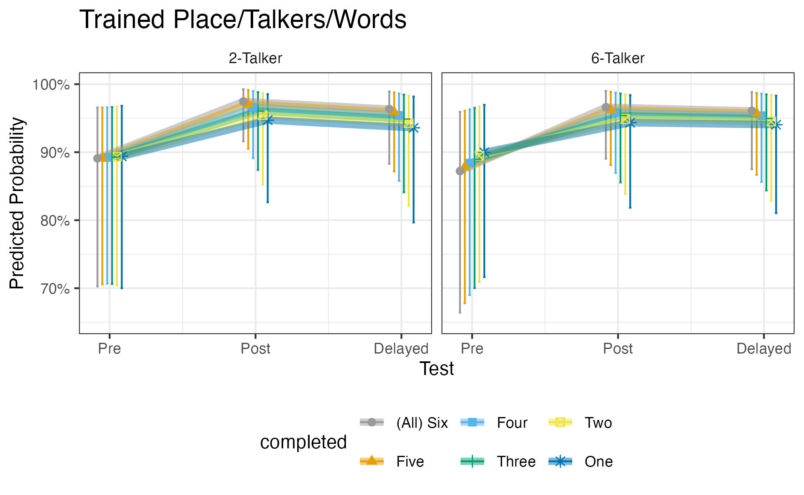

## Current Projects

### Project 1: Perception-Production Link in Second Language Speech Sound Category Learning

{width=400px}

**Funding**: National Science Foundation Grant #2309561   
**Duration**: 2022-2026  
**Team**: Shelby Bruun, Louis Gehrke, Declan Revenew, Dana Sola  
**Collaborators**: Melissa Baese-Berk (University of Chicago)  

Successful spoken language learning requires both perceiving and producing speech sounds. Although these abilities are often assumed to develop together, evidence suggests that their relationship is more complex and may change over time. Despite this, few studies have examined how perception and production interact longitudinally during second language speech learning. This project uses training studies to investigate how perception–production relationships develop over time for speech sounds. We have built a web-based training interface and developed workflows for automated extraction of key acoustic data, using Dr. VOT (https://github.com/MLSpeech/Dr.VOT).

**Key Products**:

Nagle, C., Bruun, S., & Baese-Berk, M. (under review). Scrutinizing the role of learning scenario in second language speech learning: Perception training in two languages.

Nagle, C., Bruun, S., & Baese-Berk, M. (2023). Perceptual assimilation of Spanish, Thai, and Korean stop consonants by native English speakers. In R. Skarnitzl & J. Volín (Eds.) *Proceedings of the 20th International Congress of Phonetic Sciences* (pp. 476-480). Guarant International.

---

### Project 2: Optimizing Perception Learning

{width=400px}

**Funding**: Supported by the College of Liberal Arts Undergraduate Research Assistantship Program  
**Duration**: 2022-2026  
**Team**: Shelby Bruun, Declan Revenew  
**Collaborators**: Germán Zárate-Sández (Western Michigan University)  

Learning a new language often involves mastering speech sounds that are difficult to hear and produce. Our project investigates how learners can be trained to perceive these unfamiliar sounds more effectively using high variability phonetic training, a method that exposes learners to speech from multiple talkers with feedback. We examine how factors such as the number of talkers, their presentation, and the amount of training influence learning outcomes. By embedding this training into introductory Spanish courses and having students complete sessions at home, we assess how well phonetic training works in realistic classroom settings.

**Key Products**:

Nagle, C., Zárate-Sández, G., & Bruun, S. (under review). Training L2 Spanish stop consonant voicing with two and six talkers: Learning trajectories and learner experience.

Nagle, C. (2026). From effective to optimal: A research agenda for advancing pronunciation instruction. *Language Teaching*. 1-21. Advance online publication. https://doi.org/10.1017/S0261444825101079 

Nagle, C., Bruun, S., & Zárate-Sández, G. (2025). Comparing lower and higher variability multitalker perceptual training. *Applied Psycholinguistics*, *46*, e14. https://doi.org/10.1017/S0142716425000141. Open science package: https://osf.io/mnks9/overview. 

### Project 3: Sound Communities

Austin is known for its high concentration of Spanish speakers, yet Spanish-speaking density varies considerably across the city, with some neighborhoods far more “Spanish-saturated” than others. This study investigates potential community-level effects on speech production and perception among Austin residents, asking whether living in a more Spanish-saturated neighborhood leads people to perceive and produce speech sounds in more Spanish-like ways. Our goal is to characterize the pronunciation patterns of Spanish-English bilingual Austin.

**Funding**: Supported by the College of Liberal Arts Undergraduate Research Assistantship Program  
**Duration**: 2026-  
**Team**: Louis Gehrke, Shelby Bruun